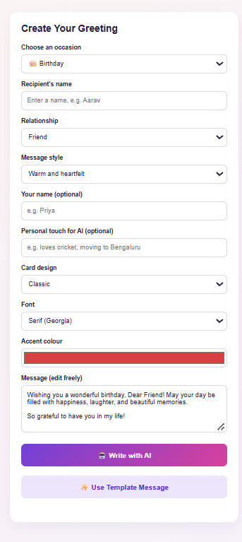

# 🎉 GREETINGLY – AI-Powered Greeting Card Generator

GREETINGLY is a personalized greeting card generator that helps users create meaningful greeting messages for different occasions.

## ✨ Features

- Generate personalized greeting messages using AI
- Choose different occasions and message tones
- Customize recipient and sender details
- Preview greeting cards instantly
- Download greeting cards as PNG images

## 🛠️ Technologies Used

- **Frontend:** HTML, CSS, JavaScript
- **Backend:** Python, Flask
- **AI Integration:** Google Gemini API

## 📁 Project Structure

```text
GREETINGLY/
├── backend/
│   ├── app.py
│   └── requirements.txt
├── frontend/
│   ├── index.html
│   ├── script.js
│   └── style.css
└── .gitignore
```

## 🚀 How to Run Locally

1. Clone this repository:

   `git clone https://github.com/kevinanthony200731-png/GREETINGLY.git`

2. Open the project folder.

3. Install dependencies:

   `py -m pip install -r backend/requirements.txt`

4. Configure your API key in `backend/.env`.

5. Start the Flask backend:

   `py backend/app.py`

6. Open the local application at `http://127.0.0.1:5000` (provided Flask is configured to serve the frontend).

## 🎯 Project Goal

To make personalized greeting card creation simple, creative, and accessible through AI-powered message generation.

## 👨‍💻 Author

Kevin Anthony

---


## 📸 Project Screenshots

### 1. Homepage


### 2. Customization


### 3. Generated Greeting Card

## 🌐 Live Demo

https://greetingly.onrender.com/
